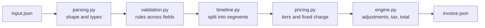

# billing-engine

Turns meter readings and mid-cycle events into an itemised utility invoice, using exact decimal arithmetic.

## Problem

A bill is more than `usage x rate`. Meters get replaced part-way through a billing period. Mechanical registers wrap back to zero. A tariff can change mid-cycle. Fixed charges have to be prorated by day, and tiered prices have to follow. If the arithmetic uses floating-point numbers or rounds in the wrong place, the customer is charged the wrong amount.

This project is a small, dependency-free library and command-line tool that handles those cases and shows its working: every invoice line says what it covers and how it was calculated.

All tariffs, readings and customers in this repository are **invented** for the examples.

## Features

- JSON in, JSON out, with every number written as text (`"47.30"`), so nothing is lost to floating point.
- Billing period split at every meter replacement and every tariff change.
- Rollover handling for meters whose register wraps (for example at 100000).
- Tiered energy pricing, with tier allowances scaled for part-period segments.
- Daily fixed charges prorated by day.
- Credits and fees, each marked taxable or not, plus a tax rate.
- Strict validation with typed errors and stable machine-readable error codes.
- Five sample datasets, each with an invoice worked out by hand.
- Standard library only. There is nothing to install.

## Technology stack

| Technology | Why |
|---|---|
| Python 3.10+ | Readable, and `decimal` is built in. |
| `decimal.Decimal` | Exact base-10 arithmetic. `0.1 + 0.2` is not `0.3` in floating point. |
| Frozen `dataclasses` | Immutable data, so each calculation step is easy to test in isolation. |
| `argparse` | A small CLI without extra dependencies. |
| `unittest` | Ships with Python, so the tests run anywhere. |
| ruff and mypy (dev only) | Lint, formatting and strict type checking in CI. |

## Architecture



| Module | Responsibility |
|---|---|
| `parsing.py` | Reads JSON. Rejects unknown fields, wrong types and JSON floats. |
| `validation.py` | Checks the pieces fit together: period, tariffs, meter-replacement chain. |
| `consumption.py` | kWh between two readings (with rollover), and splitting kWh across days. |
| `timeline.py` | Cuts the period into segments: one meter, one tariff. |
| `pricing.py` | Prices one segment. |
| `engine.py` | Wires the stages together and totals the invoice. |
| `money.py` | The rounding policy, in one place. |
| `errors.py` | One exception type per kind of failure, each with a code. |
| `cli.py` | The command line. |

### Rules the engine follows

1. **Rounding.** Each money line is rounded once to cents, exact halves away from zero. Energy is kept to 0.001 kWh. No other rounding happens.
2. **Segments.** A segment is a run of days with one meter in service and one tariff in force. The period is cut at every replacement and tariff change.
3. **Even use within a meter's service.** With only start and end readings, the engine cannot know *when* energy was used. It spreads each meter's usage evenly over its days in service. A real system with interval data would not need this assumption.
4. **No energy lost to rounding.** kWh are split using cumulative rounding, so the parts always add up to the total.
5. **Tier allowances are per full period.** For a segment covering part of the period, each allowance is scaled by `segment days / period days`.
6. **Tax.** Applied to energy, fixed charges and adjustments marked `taxable`. It is never negative.
7. **Dates.** `billing_period.end` is the first day of the *next* period. A replacement on `2026-01-11` means the new meter is in service from the start of that day.

## Installation

```bash
git clone https://github.com/FahisJ2k5/billing-engine.git
cd billing-engine
pip install -e .
```

Python 3.10 or newer. There are no runtime dependencies.

## Usage

```bash
billing-engine calculate examples/02-meter-replacement.json
billing-engine calculate examples/02-meter-replacement.json -o invoice.json
python -m billing_engine calculate examples/01-simple.json     # without installing
```

The invoice goes to standard output (or `-o`). If the input is rejected, the tool prints a JSON error on standard error and exits with code 1.

### Input format

```json
{
  "customer_id": "CUST-1002",
  "currency": "USD",
  "tax_rate": "0",
  "billing_period": { "start": "2026-01-01", "end": "2026-02-01" },
  "tariffs": [
    { "id": "RES-A", "effective_from": "2025-01-01", "daily_fixed_charge": "0.40",
      "tiers": [ { "up_to_kwh": "200", "rate": "0.10" }, { "rate": "0.15" } ] }
  ],
  "meters": [ { "id": "OLD-7", "rollover_at": "100000" },
              { "id": "NEW-8", "rollover_at": "100000" } ],
  "meter_replacements": [
    { "date": "2026-01-11", "old_meter_id": "OLD-7", "old_final_reading": "5100",
      "new_meter_id": "NEW-8", "new_initial_reading": "0" }
  ],
  "readings": [ { "meter_id": "OLD-7", "date": "2026-01-01", "value": "5000" },
                { "meter_id": "NEW-8", "date": "2026-02-01", "value": "210" } ],
  "adjustments": [ { "description": "Goodwill credit", "amount": "-5.00", "taxable": true } ]
}
```

Numbers must be strings or integers, never JSON floats. The full set of fields is in `examples/`. Unknown fields are rejected, so a typo cannot be silently ignored.

### Output format

```json
{
  "customer_id": "CUST-1002",
  "billing_period": { "start": "2026-01-01", "end": "2026-02-01", "days": 31 },
  "consumption": {
    "total_kwh": "310.000",
    "segments": [ { "start": "2026-01-01", "end": "2026-01-11", "days": 10,
                    "meter_id": "OLD-7", "tariff_id": "RES-A", "kwh": "100.000" } ]
  },
  "lines": [ { "kind": "energy", "description": "...", "quantity": "100.000",
               "unit": "kWh", "rate": "0.20", "amount": "20.00" } ],
  "summary": { "energy": "62.00", "fixed": "12.40", "tax": "0.00", "total": "74.40" }
}
```

### Error codes

| Code | Meaning |
|---|---|
| `input_file_error` / `output_file_error` | A file could not be read or written. |
| `invalid_json` | The input is not valid JSON. |
| `invalid_input` | Wrong type, missing or unknown field, bad number or date. |
| `invalid_period` | The billing period is empty, reversed, or longer than 366 days. |
| `invalid_reading` | A reading is missing, conflicting, impossible, or refers to an unknown meter. |
| `invalid_event` | A meter replacement is outside the period or breaks the chain. |
| `tariff_error` | A tariff is malformed, or none covers the start of the period. |

## Screenshots

*Placeholder: add a terminal screenshot of `billing-engine calculate examples/05-credits-and-tax.json` here.*

## Testing

```bash
python -m unittest discover -s tests -t . -v
```

| File | What it covers |
|---|---|
| `test_golden.py` | Each example must give the invoice worked out by hand. |
| `test_units.py` | Rounding, rollover, kWh allocation, tier pricing. |
| `test_validation.py` | Every kind of bad input is rejected with the right code. |
| `test_properties.py` | Invariants over 300 seeded random inputs: segments tile the period, totals equal the sum of the lines, no energy is created or lost. |
| `test_cli.py` | The command line, end to end. |

The expected invoices in `examples/expected/` were calculated by hand **before** the engine was run, so they check the code against independent arithmetic, not against its own output.

### Verification status

| Check | Status |
|---|---|
| 83 unit tests | Passed on Python 3.10 (development sandbox) and Python 3.14.2 (GitHub Codespace). |
| Mutation check | Six deliberate bugs were introduced one at a time (wrong rounding mode, unscaled tier limits, ignored rollover, tax on non-taxable credits, wrong fixed-charge days, naive kWh split). The tests caught all six. |
| Python 3.11 and 3.12 | **Not run yet.** CI covers them. |
| ruff and mypy | Passed in a GitHub Codespace: `ruff check`, `ruff format --check` and strict `mypy`. |

## Limitations

- Usage is spread evenly across each meter's days in service, as explained above.
- A meter that completes a full lap in one period reads the same as one that was unused. Equal readings are treated as zero use.
- One tax rate, one currency, no time-of-use tariffs, no demand charges.
- At most one meter is in service at a time.

## Future improvements

- Interval (half-hourly) data, so usage can be assigned to the real days it happened.
- Time-of-use and demand tariffs.
- Property-based tests with Hypothesis, which shrinks failing inputs automatically.
- Multiple taxes, and invoice rendering to PDF.
- Publish to PyPI.
